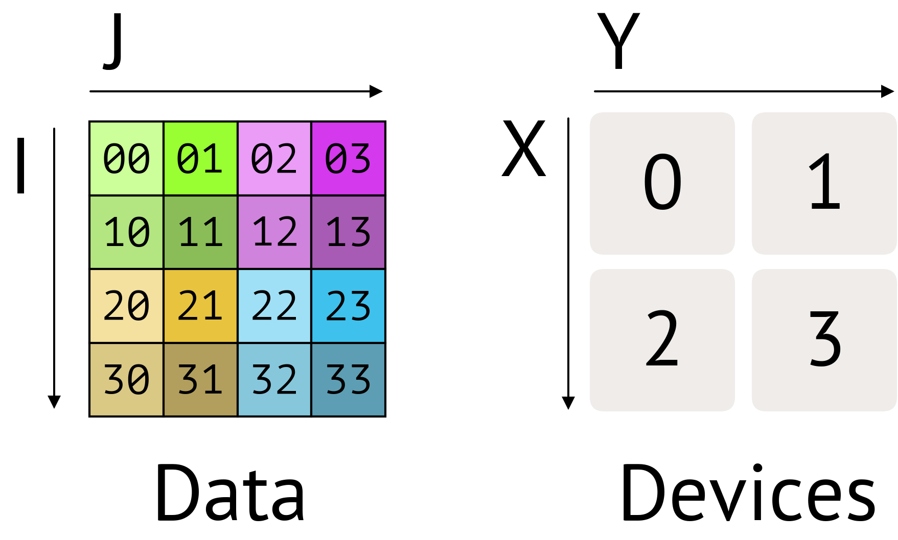
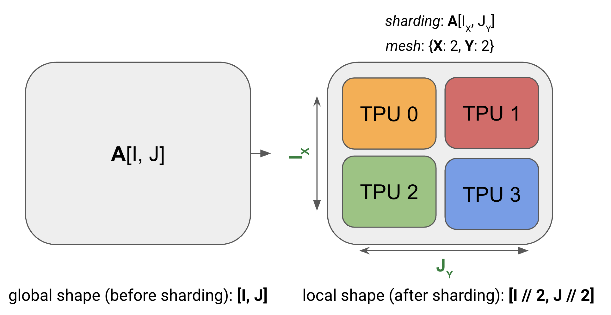
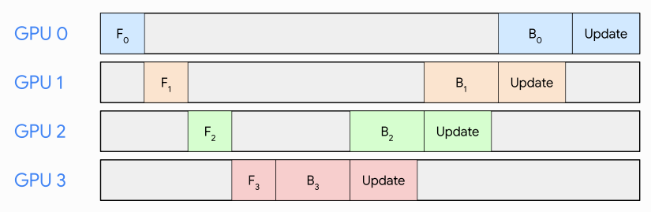
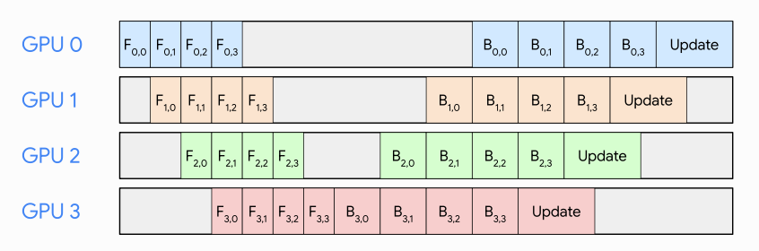
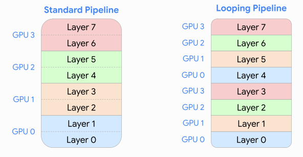
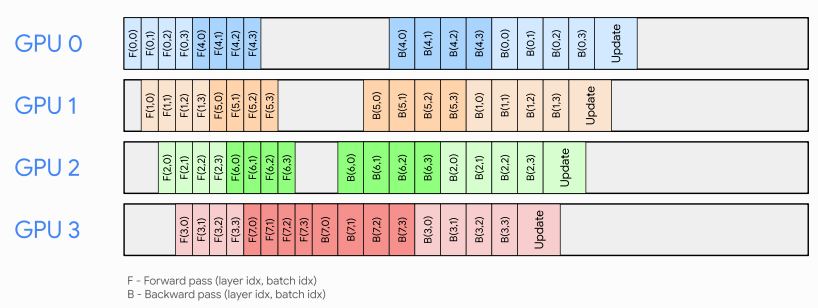

# Parallelism

Primary sources: 
- The JAX scaling book — [sharding](https://jax-ml.github.io/scaling-book/sharding/)
- HuggingFace's UltraScale Playbook - [ultrascale](https://huggingface.co/spaces/nanotron/ultrascale-playbook)
- Also some from [Lippe's notes](https://uvadlc-notebooks.readthedocs.io/en/latest/tutorial_notebooks/scaling/JAX/overview.html). 
- Inference is a different problem (no backward pass, decode is bandwidth-bound) and has its own sharding rules in [Inference §Sharding for inference](inference.md#sharding-for-inference). See also [Basics](basics.md), [TPUs & Rooflines](tpus.md), [GPUs](gpus.md).

## Recipe

### TLDR

Suppose we have a fixed number of GPUs. How do we distribute training to "maximize training throughput" out of our GPUs (Read: utilize all GPUs but be compute-bound)? 

- First, we need to shard appropriately to fit training in memory.
- After which, suppose we "distribute training" over all our GPUs. 
- The challenge with this is that with increased parallelism, we increase communication cost (relative to the per-GPU compute).
- If we end up being bandwidth-bound, we want to employ different sharding strategies to move us to the compute-bound regime. This maximizes the throughput our hardware supports. 
  - We typically have some [critical batch size](../optimization/scaling.md#critical-batch-size), above which the gradient signal is clean enough such that we are being wasteful by processing more tokens. This sets an upper bound on the global batch size. This is important because otherwise we can just "trivially" increase batch size to remain compute-bound

### Arithmetic Intensity

- Ultimately, we want every collective's **FLOPs per byte moved to exceed $`\alpha = C/W`$** — peak FLOPs/s over the bandwidth of the link the collective runs on. 
- What differs between hardware is only _which_ $`W`$:

| Fabric | $`C`$ (bf16 FLOPs/s) | $`W`$ (bytes/s) | $`\alpha`$ |
|---|---|---|---|
| TPU v5p, one ICI axis (bidirectional) | $`4.59 \times 10^{14}`$ | $`1.8 \times 10^{11}`$ | 2550 |
| TPU v5e, one ICI axis | $`1.97 \times 10^{14}`$ | $`9 \times 10^{10}`$ | ~2200 |
| TPU v5p, DCN between pods (per slice) | | | ~73,440 |
| H100, NVLink within a node (per-GPU egress) | $`9.9 \times 10^{14}`$ | $`4.5 \times 10^{11}`$ | 2200 |
| H100, InfiniBand across nodes (per-node egress) | $`9.9 \times 10^{14}`$ | $`4 \times 10^{11}`$ | 2475 |

- **Takeaway: ~2,200–2,550 tokens per chip on every fabric.** ($`C`$ and $`W`$ have scaled together — except across nodes on B200, where FLOPs rose but IB didn't: $`2.25 \times 10^{15} / 4 \times 10^{11} \approx 5600`$)
- Multipliers on $`W`$ is where TPUs and GPUs differ:
  - TPU: giving a collective $`M`$ mesh axes multiplies $`W_{ici}`$ by $`M`$ (the $`M_X, M_Y`$ in [Combining FSDP and TP](#combining-fsdp-and-tp)). A torus has 2–3 axes to spend, and they're uniform — no cliff between "near" and "far" chips until you leave the pod for DCN
  - GPU: no axis multiplier — past the node there is exactly one 400 GB/s pipe. What you get instead is the $`(n-1)/n`$ ring factor (which often motivates 2 node setups)

### The three questions

One question per step below. Every α condition depends on either the batch (question 2) or the link (question 3):

1. **Does each GPU's share fit in memory?** (Step 1) A hard constraint. It picks the sharding, but says nothing about speed
2. **Is the batch big enough to stay compute-bound?** (Step 2) GBS is fixed by optimization. The batch-hungry axes (DP/FSDP, PP) need a share of it to hide their comms or fill their pipeline; the batch-free ones (TP, EP) don't
3. **Are the links fast enough to stay compute-bound, and are the comms hidden?** (Step 3)

### Step 1: Fit a training step in memory

Terminology: a **replica** is the group of GPUs that jointly processes the same samples — the model-parallel axes (TP, PP, CP) live inside it, and dp counts how many replicas run side by side on different samples. With ZeRO the weights are sharded _across_ replicas, but each replica still computes on its own samples.

Step 1 picks the sharding — tp, pp, cp (the replica shape), ep and the ZeRO stage — so that every GPU's share fits. Several shardings will; Steps 2–3 choose between them.

Per-GPU memory = bf16 params + fp32 master weights + bf16 grads + optimizer states + activations (see [Basics §Training vs Inference](basics.md#training-vs-inference)). Each axis divides a different term:

| Axis | Weights + optimizer state | Activations |
|---|---|---|
| DP | replicated | unchanged at a given mbs — more dp only lets mbs shrink, down to 1 sample |
| ZeRO-1 / 2 / 3 | optimizer states ÷ dp; ZeRO-2 also grads; ZeRO-3 (= FSDP) also params | same as DP |
| TP (+SP) | ÷ tp | ÷ tp — along $`F`$ (and heads) inside the matmuls, along $`s`$ in the SP regions (replicated there without SP) |
| PP | ÷ pp, by layers | ≈ unchanged — each stage keeps ~pp microbatches in flight |
| CP | unchanged | ÷ cp, along $`s`$ |
| EP | expert weights ÷ ep; attention and shared weights replicated | unchanged per token |

- **A microbatch is split across its replica's GPUs.** A microbatch is mbs samples of seq tokens each; TP (+SP) and CP divide its activations, PP doesn't (stage 0 holds ~pp microbatches × L/pp layers ≈ one full microbatch). So the natural unit is the per-GPU share: 

  $`\displaystyle t = \frac{\text{mbs} \cdot \text{seq}}{\text{tp} \cdot \text{cp}} \quad \text{tokens per GPU per microbatch}`$ 

  - Activation memory scales with $`t`$ (times the layer count), not with tp or cp separately. **Step 1's output is a sharding plus the largest $`t`$ that fits**; Step 2 turns that into an mbs
- **Fitting is a constraint.** Several combinations will fit. Identify what's too big, then pick the axis that shrinks it:
  - Parameters + optimizer state too big → **ZeRO-3** (model-agnostic, off the critical path), **TP** (≤ ~8-way) or **PP** — which one is decided by Step 2's checks
  - One layer's gathered weights too big for HBM → **TP** — ZeRO-3 still materialises a full layer at a time
  - Activations too big (the largest $`t`$ that fits is too small) → recompute, **TP** (÷ tp), or **CP** when sequence length is the cause; a smaller mbs + more gradient accumulation also works, down to mbs = 1
  - MoE → **EP**: the experts are where the parameters are, and DP's threshold inflates by $`E/k`$ ([Data parallelism](#data-parallelism))
- Worked example: 70B with Adam is ≈ 1.1 TB of state, on 80 GB GPUs. TP=8 → 140 GB per GPU, doesn't fit. TP=8 × PP=2 → 70 GB, fits tightly. TP=8 + ZeRO-3 over ≥ 2 replicas → fits. **Three configurations fit. We choose which configuration in Step 2: ZeRO-3 needs $`t > \alpha`$ per microbatch, PP needs enough microbatches (and usually rules out ZeRO-3).** 
- GPU-rich vs GPU-poor (cheatsheet from [ultrascale](https://huggingface.co/spaces/nanotron/ultrascale-playbook)): 
  - GPU-rich: < 10B → a single technique, TP or ZeRO-3 with full recompute across 8 GPUs; 10–100B → TP=8 + PP, TP=8 + ZeRO-3, or pure ZeRO-3; 512+ GPUs → combine DP with TP or PP; 1024+ → TP=8 + DP (ZeRO-2) + PP. Long context → add CP; MoE → add EP
  - GPU-poor case: full activation recompute (~⅓ more FLOPs) and gradient accumulation — trade compute and step time for memory

### Step 2: Hit the target global batch size

- GBS is set by optimization dynamics (see [critical batch size](../optimization/scaling.md#critical-batch-size)). Given Step 1's sharding, four factors multiply up to it: 

  $`\displaystyle \text{GBS (tokens)} = \text{mbs} \times \text{seq} \times \text{dp} \times \text{gas}`$ 

  - mbs: samples per forward pass, per replica (micro-batch size)
  - seq: tokens per sample (sequence length), fixed by the data
  - dp: number of replicas. One replica occupies tp·pp·cp GPUs (not ×ep: EP ranks see different tokens, so ep is carved out of dp — see [CP](#context-parallelism-cp)'s `data_parallel_size`)
  - gas: gradient-accumulation steps, i.e. forward/backward passes per optimizer step
- Ultrascale's playbook fills dp before gas because **dp spends GPUs (same step time); gas spends time (same GPUs)**:
  1. **mbs: the largest whose per-GPU share $`t`$ fits** (Step 1) — bigger microbatches also mean bigger matmul tiles. With ZeRO-3 it must also clear α. If memory caps $`t`$ below α, ZeRO-3 can't be compute-bound at any mbs → Fallback to ZeRO-1 + gas, or PP (the [H100 case study](#h100-cluster))
  2. **dp: as many replicas as the GPUs allow** — $`N / (\text{tp} \cdot \text{pp} \cdot \text{cp})`$ for $`N`$ total GPUs — up to the sample cap $`\text{GBS} / (\text{mbs} \cdot \text{seq})`$, since each replica needs ≥ 1 microbatch per step
  3. **gas: the remainder**, $`\text{GBS} / (\text{mbs} \cdot \text{seq} \cdot \text{dp})`$. If it comes out < 1 (too many GPUs for the batch), the playbook's options are fewer GPUs, a larger GBS or a smaller mbs — or move GPUs out of dp into tp, pp or cp
- **Why CP is the knob for long sequences**: CP makes a long sequence look like cp shorter ones to everything but attention, so it shrinks per-GPU activations (Step 1) and multiplies the GPUs a sample can occupy (Step 2) at once.
- **Then check that the batch keeps the batch-hungry axes busy.**:
  - **DP / ZeRO-1** reduce gradients once per step, so they need **tokens per GPU per step $`\text{GBS}/N > \alpha`$** — otherwise **comms-bound**. Intuition: DP moves weights, and this is "amortized" over every token in the step
  - **ZeRO-3 / FSDP** re-gathers weights every microbatch, so it needs **$`t > \alpha`$ per microbatch** (sub-step 1). ZeRO-2 also pays its gradient reduce-scatter every microbatch
  - **PP** needs **gas ≫ pp** — otherwise **idle-bound**: each stage idles ≈ $`(pp-1)/\text{gas}`$ of the step while the pipeline fills and drains. Its comms are batch-free, but at fixed $`N`$ adding PP shrinks dp by pp and grows gas by pp, so the bubble ≈ $`(\text{mbs} \cdot \text{seq}/\text{tp}) / (\text{GBS}/N)`$ depends on tokens per GPU — the same currency as DP
  - **TP and EP** need neither: their thresholds ($`F/Y > \alpha`$ and the $`F_{expert}`$ regimes) have no $`B`$ in them — they move activations, so comms and compute both scale with the batch. They're checked against the link instead (Step 3)
- When a check fails, we need to change our parallelism strategy to be compute-bound.

Worked example: 1024 sequences of 4096 tokens (≈ 4.2M tokens) at mbs = 1 with TP=8, so one replica is 8 GPUs and $`t = 4096/8 = 512`$:

| GPUs | dp | gas | DP / ZeRO-1: $`\text{GBS}/N`$ per step | ZeRO-3: $`t`$ per microbatch |
|---|---|---|---|---|
| 1,024 | 128 | 8 | 4,096 ✓ | 512 ✗ |
| 8,192 | 1,024 | 1 | 512 ✗ | 512 ✗ |
| 16,384 | capped at 1,024 | < 1 | the extra GPUs must go into tp, pp or cp | |

- At 1,024 GPUs ZeRO-1 is compute-bound but ZeRO-3 isn't, and more gas can't rescue it — only mbs ≥ 5 ($`t \geq 2560`$) does, if it fits. At 8,192 GPUs neither is, and this is the hard case: 8-way PP across nodes lowers DP's threshold to ≈ 2475/8 ≈ 309 < 512, but leaves gas = 8 and a ≈ 7/8 bubble — it needs an interleaved or zero-bubble schedule (or fewer GPUs)

### Step 3: Optimize throughput

- Steps 1–2 leave the configurations that fit and that the batch keeps compute-bound; this step picks the fastest
- **Which link each axis runs on.** The α tests left here have no $`B`$ in them, only the link's α:
  - Per-layer, critical-path traffic (TP, EP's AllToAll, CP's KV ring) goes on the fastest link. TP needs $`F/Y > \alpha`$ for the link it runs on, which caps it at ~one/two node on GPUs; EP needs $`F > 8\alpha`$ once it crosses nodes
  - Once-per-step, per-stage traffic and non-critical path traffic (DP/FSDP, PP) can cross the slow one
  - That gives Llama 3's mesh order, innermost → outermost, of TP, CP, PP, DP — TP=8, PP=16, DP=128 on 16k GPUs, with CP=16 switched on only for the 128k-context stages ([Llama 3, arXiv 2407.21783](https://arxiv.org/abs/2407.21783) §3.3), and on TPUs, TP/FSDP inside the pod and DP over DCN
- The conventional path (playbook), in order: **scale TP/EP up to the node size** (EP on a MoE's expert layers; fast intra-node links; it reduces how much of the other axes you need) → **increase DP with ZeRO-3 while holding the target GBS** → **switch to PP when DP's communication becomes the bottleneck** → then **tune mbs** to balance memory, matmul size and comms. This is the three questions in procedure form: TP/EP first because they're batch-free and on the fast link, DP because it's the cheapest to hide, PP when DP hits α
- **Compute-bound is necessary, not sufficient.** Two configurations can both satisfy $`T_{comms} < T_{math}`$ and still differ in MFU:
  - _Exposed vs hidden comms_: the ratio says comms are hideable, not hidden. TP/EP's collectives sit on the critical path and are only hidden with async TP or, for EP, by overlapping one microbatch's AllToAll with another's compute; DP/FSDP overlap by construction. At equal ratios, prefer the axis that overlaps
  - _Bubbles_: whatever's left of Step 2's PP check — PP loses ≈ $`(pp-1)/\text{gas}`$ of the step whatever the comms; zero-bubble schedules shrink it, at a code cost
  - _Load imbalance_: EP's routing is data-dependent, so the GPU holding a popular expert does more work and the rest wait for it at the AllToAll
  - _Local kernel efficiency_: compute-bound against the network ≠ high utilisation on the SMs. TP slices $`F`$ into thin matmuls, and a small mbs gives small tiles — hence "play with mbs"
  - _Memory headroom_: near the HBM limit you pay recompute (~⅓ more FLOPs for full checkpointing) or allocator thrash — the playbook's 80B-on-4-nodes example fits but runs badly
  - _Tails that can't overlap_: the last layer's gradient reduce, PP waiting for its final microbatch, ZeRO-3's first gather
  - _Simplicity_: ZeRO and PP are model-agnostic; TP needs model-specific sharding (+SP). The playbook's benchmarks saw the TP-vs-PP ranking flip with implementation quality
- **So the recipe below is the conventional, lowest-risk path to compute-bound; the residual is settled by benchmarking**

### The recipe

- **Relatively small dense model**: aggressive FSDP if you have the batch size (~2500 tokens per GPU per microbatch, since FSDP re-gathers every microbatch), plus some PP or TP if needed
  - FSDP's comms are fully off the critical path, so it's the cheapest to hide
  - TP has little to give a small model — its cap $`F/\alpha`$ is ~4-way at $`F = 11k`$ (7B) and ~2-way at $`F = 5.5k`$ (1B). 
  - "Plus PP or TP if needed" is for when the batch is too thin for FSDP alone — they shrink the weight bytes each replica gathers. If activations at mbs = 1 don't fit, that's recompute, TP (+SP) or CP; PP doesn't shrink them
- **Larger dense model**: 1–2-node TP + many-node PP + pure DP. On a TPU: TP/FSDP within the ICI slice, pure DP across pods over DCN
  - TP, then PP, then DP (Megatron's classic 3D layout). 
  - TP first: batch-free, shrinks weights _and_ activations, up to its ~8-way cap — which happens to be one node. 
  - PP second: the only axis that crosses nodes for ~free, eats devices without needing batch, and divides the weight bytes FSDP must gather per replica. 
  - DP last, in the ZeRO-1 flavour since PP breaks ZeRO-3's amortization. **CP is orthogonal** — add it when sequence length, not parameter count, is the memory problem
  - Why pure DP across pods, TP/FSDP inside (the [case study](#tpu-v5p)): question 3. 
    - The slow link gets the traffic that's smallest, least frequent and most overlappable — pure DP reduces gradients once per step, async behind the backward pass, and since the pod already shards the weights internally, each chip only exchanges its own shard with its twin in the other pod. FSDP over DCN would gather weights every layer on the slow link; TP would put critical-path activations on it.
- **MoE**: the same, plus EP, which is generally preferred to TP. $`F > 8\,C/W_{node}`$ → lots of multi-node EP; otherwise roughly 2-node EP. Why EP over TP:
  - Experts have small $`F`$ — DeepSeek-V3's is 2048, below $`\alpha`$ before you split it at all, so TP on an expert is comms-bound. 
  - EP keeps each expert whole and splits along $`E`$ instead; its comms are the sparse AllToAll (each token's activation moves only to its $`k`$ experts) vs TP's AllGather + ReduceScatter of every token every layer
  - EP also shards exactly where the parameters live, fixing the $`E/k`$ inflation DP suffers
- **PP** works well if you can handle the code complexity of zero-bubble schedules and keep batch sizes large enough to avoid DP bottlenecks. It usually rules out ZeRO-3 (which would involve an AllGather per microbatch at every stage, unless weights stay gathered across microbatches) but ZeRO-1/2 are fine
- **Any model parallelism that spans nodes reduces the FSDP cost** — the reason the mixes above exist
- Inference ([vLLM](https://www.aleksagordic.com/blog/vllm)): TP within the node → PP across nodes if it still doesn't fit → DP replicas behind a lightweight coordination layer, load balancing across replicas, one or more API servers in front

## Sharding and collectives

_From [sharding](https://jax-ml.github.io/scaling-book/sharding/). This is the primitives layer — everything in §Strategies is an application of it._

### Notation

- **Mesh**: the device mesh `Mesh(devices=((0, 1), (2, 3)), axis_names=('X', 'Y'))` tells us we have 4 TPUs in a 2×2 grid, with axis names $`X`$ and $`Y`$
- **Sharding**: $`A[I_X, J_Y]`$ tells us to shard the first axis $`I`$ along the mesh axis $`X`$, and the second axis $`J`$ along the mesh axis $`Y`$. This sharding tells us that each shard holds $`1/(|X| \cdot |Y|)`$ of the array
- [Source](https://jax-ml.github.io/scaling-book/sharding/)
- Global shape (before sharding) vs local shape (after sharding, i.e. what each device actually holds):
  - [Source](https://jax-ml.github.io/scaling-book/sharding/)

### Which sharding needs which collective

- **Case 1**: neither input is sharded along the contracting dimension. We can multiply local shards without any communication
  - $`A[I_X, J] \cdot B[J, K_Y] \to C[I_X, K_Y]`$
- **Case 2**: one input has a sharded contracting dimension. We typically "AllGather" the sharded input along the contracting dimension
  - $`A[I, J_X] \cdot B[J, K] \to C[I, K]`$
  - $`\textbf{AllGather}_X[I, J_X] \to A[I, J]`$, then $`A[I, J] \cdot B[J, K] \to C[I, K]`$
- **Case 3**: both inputs are sharded along the contracting dimension. We can multiply the local shards, then "AllReduce" the result
  - $`A[I, J_X] \cdot_{\text{LOCAL}} B[J_X, K] \to C[I, K]\{U_X\}`$ — each device along the $`X`$ dimension will be left with different partial sums of this final desired product
  - $`\textbf{AllReduce}_X C[I, K]\{U_X\} \to C[I, K]`$
- **Case 4**: both inputs have a non-contracting dimension sharded along the same axis. We cannot proceed without AllGathering one of the two inputs first
  - $`A[I_X, J] \cdot B[J, K_X] \to C[I_X, K_X]`$ is not allowed — we need to AllGather one term first

### The collectives and their costs

- **AllGather** copies the shards spread across devices onto EACH device along that axis. In our notation, it removes the sharding along an axis (drops a subscript)
  - Cost, for an array of $`V`$ bytes (its full, gathered size — not one shard): 

    $`\displaystyle T_{total} = \max\left[\dfrac{T_{min} \cdot \sum_i |X_i|}{2}, \dfrac{V}{W_{ici} \cdot N_{axes}}\right]`$ 

    with $`W_{ici}`$ = bidirectional bandwidth of one ICI link, $`|X_i|`$ = devices along mesh axis $`i`$, $`N_{axes}`$ = number of mesh axes the collective spans, and $`T_{min}`$ = the minimum time for one hop (the latency term)
  - The bandwidth term (second) doesn't depend on the number of shards $`|X|`$ — the more shards, the more hops, but the fewer bytes that need to move per hop
  - Or more simply, just $`T_{total} = \dfrac{V}{W_{ici}}`$
- **ReduceScatter** sums an unreduced/partially summed array, such that each device now has a shard of the fully summed array
- Generally, an **AllReduce** is twice as expensive as an AllGather. One way to see this is to note that an AllReduce can be expressed as a composition of two other primitives: a ReduceScatter and an AllGather
  - $`\textbf{ReduceScatter}_{Y,J} : A[I_X, J]\{U_Y\} \to A[I_X, J_Y]`$
  - $`\textbf{AllGather}_Y : A[I_X, J_Y] \to A[I_X, J]`$
- **AllToAll**: whereas the AllGather not only moves shards but ensures all devices have the full copy, the AllToAll ends with each device still holding a shard — so there is less work (no copy)
  - $`\textbf{AllToAll}_{X,J} A[I_X, J] \to A[I, J_X]`$
  - General cost: $`T_{\text{comms per AllToAll}} = \dfrac{V \cdot \max_i |X_i|}{4 \cdot N \cdot W_{ici}}`$, with $`N`$ = total devices. For a 1D mesh this reduces to $`V / (4 \cdot W_{ici})`$ — $`\frac14`$ the cost of an AllGather
  - **Why the factor of 4, from not needing a copy**: AllGather must *replicate* — every byte needs to reach all $`N`$ devices, which costs a path of length $`N`$. AllToAll only needs to *relocate* — each byte has exactly one destination, so it takes the shortest path on the bidirectional ring: at most $`N/2`$ (left or right), and the **mean** element travels half that, $`N/4`$.
- **On GPUs** the same four collectives (NCCL, "nickel", and NVSHMEM) run on a switched tree instead of a ring, with _two_ bandwidths — $`W_{GPU}`$ (NVLink egress per GPU, inside a node) and $`W_{node}`$ (InfiniBand egress per node) — see [GPUs §Networking](gpus.md#networking). Three things change:
  - **AllGather / ReduceScatter within a node: nothing.** $`T = V \cdot (N-1)/(N \cdot W_{GPU}) \to V/W_{GPU}`$ — the ring cost with $`W_{ici} \to W_{GPU}`$; the switch gives every GPU its full egress bandwidth to whoever it's sending to. AllReduce = RS + AG = 2× as usual
  - **AllToAll within a node is a direct send** (full all-to-all connectivity): each GPU holds $`V/N`$ bytes and sends $`V/N^2`$ to each of $`N-1`$ peers: 

    $`\displaystyle T_{AllToAll} = \frac{V \cdot (N-1)}{W_{GPU} \cdot N^2} \approx \frac{V}{W_{GPU} \cdot N}`$ 

    vs $`V/4W`$ on the ring → at $`N = 8`$ a 2× theoretical speedup ($`V/8W`$ vs $`V/4W`$). MoE wants a **sparse / ragged AllToAll** — at most $`k`$ of the $`N`$ output shards are non-zero, since each token goes to $`k`$ experts — costing $`\min(k/N, 1) \cdot V/(W_{GPU} \cdot N)`$
  - **Across nodes, reductions go up the tree**: first within the node, then at the leaf, then at the spine, running the normal algorithm at each level. For an AllReduce this moves _less_ data overall — after the node-level reduce only $`V`$ bytes egress up to the leaf instead of $`V \cdot N`$. To first order $`T_{AG\ \text{or}\ RS} \approx V/W_{node}`$. 
    - The precise rule for a tree $`\textbf{AllGather}_X(A_Y\{U_X\})`$ with $`Y`$ the inner axis: 

    $`\displaystyle T = V \cdot \max_{\text{depth } i}\left[\frac{D_i - 1}{D_i \cdot \max(Y, S_{i-1}) \cdot W_{\text{link } i}}\right]`$ 

    with $`D_i`$ = children at depth $`i`$, $`W_{\text{link } i}`$ = bandwidth of the link from each child up to level $`i`$, and $`S_i`$ = size of the subtree below level $`i`$. Roughly: the more GPUs or nodes we span, the more aggregate bandwidth we get — but only within that level of the tree. 
    - **In-network reductions (SHARP)**: the InfiniBand switches can do the reduction themselves — in theory close to halving an AllReduce, ~30% in practice

| Operation | Syntax | TPU ring ($`W_{ici}`$) | GPU within a node ($`W_{GPU}`$) | GPU across nodes ($`W_{node}`$) |
|---|---|---|---|---|
| **AllGather** (removes a subscript) | $`[A_X, B] \to [A, B]`$ | $`V`$ / ($`W_{ici}`$ × num axes) | $`V / W_{GPU}`$ | $`V / W_{node}`$ — tree, reduce within the node first |
| **ReduceScatter** (sums, adds a subscript) | $`[A, B]\{U_X\} \to [A_X, B]`$ | same as AllGather | same | same |
| **AllReduce** (removes a $`\{U_X\}`$) | $`[A_X, B]\{U_Y\} \to [A_X, B]`$ | 2 × AllGather | 2 × AllGather | 2 × AllGather, less with SHARP |
| **AllToAll** (reshards without replicating) | $`[A, B_X] \to [A_X, B]`$ | AllGather / 4 (bidirectional ring) | $`V / (N \cdot W_{GPU})`$ — AllGather / 8 at $`N{=}8`$ | only the $`(Z-8)/Z`$ of shards on other nodes leaves the node — see [EP](#expert-parallelism-ep) |

## Strategies

_From [training](https://jax-ml.github.io/scaling-book/training/) and [GPUs](https://jax-ml.github.io/scaling-book/gpus/). For each strategy the same three questions: **what is sharded**, **what is communicated per step**, **when do we go bandwidth-bound**.

For simplicity’s sake, we’ll approximate a Transformer as a stack of MLP blocks. 

### Reference: a single 2-matmul layer

The strategies below all shard this same toy layer — $`\text{In}[B,D] \to \text{Tmp}[B,F] \to \text{Out}[B,D]`$ — so its forward/backward can be checked against each strategy's sharded version.

- **Forward pass**: need to compute $`\text{Loss}[B]`$
  1. $`\text{Tmp}[B,F] = \text{In}[B,D] \cdot_D W_{in}[D,F]`$
  2. $`\text{Out}[B,D] = \text{Tmp}[B,F] \cdot_F W_{out}[F,D]`$
  3. $`\text{Loss}[B] = \dots`$
- **Backward pass**: need to compute $`dW_{out}[F,D], dW_{in}[D,F]`$ — each line below is one of the two general backward formulas from [FLOPs](basics.md#basics) ($`\partial L/\partial A = (\partial L/\partial C)B^\top`$, $`\partial L/\partial B = A^\top(\partial L/\partial C)`$), applied to the two forward matmuls in reverse order
  1. $`d\text{Out}[B,D] = \dots`$
  2. $`dW_{out}[F,D] = \text{Tmp}[B,F]^\top \cdot d\text{Out}[B,D]`$
  3. $`d\text{Tmp}[B,F] = d\text{Out}[B,D] \cdot W_{out}[F,D]^\top`$
  4. $`dW_{in}[D,F] = \text{In}[B,D]^\top \cdot d\text{Tmp}[B,F]`$
  5. $`d\text{In}[B,D] = d\text{Tmp}[B,F] \cdot W_{in}[D,F]^\top`$ (_needed for previous layers_)

### Summary

([scaling book](https://jax-ml.github.io/scaling-book/training/); CP/SP/EP per the [Megatron parallelisms guide](https://docs.nvidia.com/nemo/megatron-bridge/latest/parallelisms.html))

1. **Data parallelism**: _activations sharded along batch, parameters and optimizer state are replicated on each device. Communication only occurs during the backwards pass._ 

   $`\displaystyle \text{In}[B_X, D] \cdot_D W_{in}[D, F] \cdot_F W_{out}[F, D] \to \text{Out}[B_X, D]`$ 

2. **Fully-sharded data parallelism (FSDP or ZeRO-3)**: _activations sharded along batch (like pure data parallelism), parameters sharded along the same mesh axis and AllGathered just-in-time before use in the forward pass. Optimizer state also sharded along batch. Reduces duplicated memory._ 

   $`\displaystyle \text{In}[B_X, D] \cdot_D W_{in}[D_X, F] \cdot_F W_{out}[F, D_X] \to \text{Out}[B_X, D]`$ 

3. **Tensor parallelism (also called Megatron sharding or model parallelism)**: _activations sharded along $`D`$ ($`d_{model}`$), parameters sharded along $`F`$ ($`d_{ff}`$). AllGather and ReduceScatter activations before and after each block. Compatible with FSDP._ 

   $`\displaystyle \text{In}[B, D_Y] \cdot_D W_{in}[D, F_Y] \cdot_F W_{out}[F_Y, D] \to \text{Out}[B, D_Y]`$ 

   - **Important intuition**: FSDP moves **weights**, TP moves **activations**.
4. **Sequence parallelism (SP)**: _extends tensor parallelism to shard the non-matmul ops (LayerNorm, dropout) along the sequence dimension too — only active when TP is, and covers exactly what plain TP leaves redundantly replicated._
5. **Context parallelism (CP)**: _shards activations along the sequence dimension across all layers (not just the ops SP covers) — the lever for long-context training; attention is the one op that then needs communication (K/V from other chunks)._
6. **Pipeline parallelism**: _weights sharded along the layer dimension, activations microbatched and rolled along the layer dimension. Communication between pipeline stages is minimal (just moving activations over a single hop)._
7. **Expert parallelism (EP)**: _shards a MoE model's experts (not activations or a dense weight) across devices; routing tokens to their expert requires an AllToAll rather than an AllGather/ReduceScatter._

Summary [α table](#arithmetic-intensity):

| Strategy | What is communicated | Compute-bound when | TPU (v5p) | GPU (H100) |
|---|---|---|---|---|
| DP / FSDP | weights: grads (DP) or params + grads (FSDP); off the critical path | $`B/X > \alpha`$ | ~2550 tokens/chip, ÷ $`M_X`$ ICI axes | ~2200 in-node, ~2475 across nodes; ÷2 for a 2-node ring; × $`E/k`$ for MoE |
| TP | activations, every block, on the critical path | $`Y < M_Y \cdot F/\alpha`$ | ~11-way per axis at $`F{\approx}30k`$ | $`F/2475`$ → 8-way (one node), 16-way over exactly 2 nodes |
| FSDP + TP | both — and each shrinks the other's communicated bytes | $`B/N > \alpha^2 / (M_X M_Y F)`$ | ~100 tokens/chip at $`F{=}32k`$ | same idea: any multi-node model parallelism cuts FSDP's cost |
| PP | one microbatch of activations per stage boundary | ≈ free: $`1.5 \cdot 2BD / (W N_{layers})`$ | — | the cheap way across nodes; but ZeRO-3 stops amortizing |
| EP | routed tokens, sparse AllToAll | few nodes: $`F > \alpha (Z-8)/k`$; wide: $`F > 8\alpha`$ | AllToAll is $`V/4W`$, no node term | ~2-node EP unless $`F > 8\alpha \approx 20k`$ |
| CP | K/V chunks around a ring | cheap at long context (overlaps attention) | | |

### Data parallelism

Source: [scaling book](https://jax-ml.github.io/scaling-book/training/)

- Syntax: 

  $`\displaystyle \text{In}[B_X, D] \cdot_D W_{in}[D, F] \cdot_F W_{out}[F, D] \to \text{Out}[B_X, D]`$ 

- Activations sharded along batch dimension, weights fully replicated
- Forward pass is normal — weights are replicated, so each device just runs the reference layer's forward pass on its own batch shard, no communication needed
- Backward pass: each device computes a **local, unreduced** gradient from its own batch shard (the $`\{U_X\}`$ tag), then AllReduces it across the batch axis to get the true (summed) gradient
  1. $`d\text{Out}[B_X,D] = \dots`$
  2. $`dW_{out}[F,D]\{U_X\} = \text{Tmp}[B_X,F]^\top \cdot d\text{Out}[B_X,D]`$
  3. $`dW_{out}[F,D] = \textbf{AllReduce}_X\left(dW_{out}[F,D]\{U_X\}\right)`$ (_not on the critical path — can be done async_)
  4. $`d\text{Tmp}[B_X,F] = d\text{Out}[B_X,D] \cdot W_{out}[F,D]^\top`$
  5. $`dW_{in}[D,F]\{U_X\} = \text{In}[B_X,D]^\top \cdot d\text{Tmp}[B_X,F]`$
  6. $`dW_{in}[D,F] = \textbf{AllReduce}_X\left(dW_{in}[D,F]\{U_X\}\right)`$ (_not on the critical path — can be done async_)
  7. $`d\text{In}[B_X,D] = d\text{Tmp}[B_X,F] \cdot W_{in}[D,F]^\top`$ (_needed for previous layers_)
- **Not on the critical path**: each AllReduce can be performed whenever convenient and doesn't block subsequent ops — in particular it can overlap with the backward pass of earlier layers, which is why DP communication is so cheap to hide
- Communication cost, per layer: $`T_{comms} = \dfrac{2 \cdot 2 \cdot 2 \cdot DF}{W}`$ — AllReduce is $`2\times`$ an AllGather, bf16 is 2 bytes/param, and there are 2 weight matrices ($`W_{in}, W_{out}`$), each $`DF`$ params. $`W`$ is $`W_{ici}`$ on a TPU; on a GPU it's $`W_{GPU}`$ while the DP axis stays inside the node and $`W_{node}`$ once it crosses (tree reduce, node first)
- Compute cost, per layer: $`T_{math} = \dfrac{4 \cdot 2(B/X)DF}{C}`$ — 4 matmuls in the backward pass ($`dW_{out}, d\text{Tmp}, dW_{in}, d\text{In}`$), each $`2(B/X)DF`$ FLOPs at per-chip batch size $`B/X`$
- **Compute-bound** when $`T_{math} > T_{comms}`$, i.e. per-chip batch size $`B/X > C/W = \alpha`$ — ≈2550 tokens on TPU v5p (one ICI axis; ÷ $`M_X`$ if FSDP gets more), ≈2200 tokens per GPU inside an H100 node, ≈2475 across nodes
- **MoE** ($`E`$ experts, $`k`$ active per token): $`E\times`$ the weights to reduce for only $`k\times`$ the FLOPs: 

  $`\displaystyle T_{math} = \frac{2 \cdot 2 \cdot 2 \cdot k \cdot BDF}{X \cdot C}, \qquad T_{comms} = \frac{2 \cdot 2 \cdot 2 \cdot EDF}{W} \quad\Rightarrow\quad \frac{B}{X} > \frac{E}{k} \cdot \alpha`$ 

  - The critical per-device batch inflates by $`E/k`$, the ratio of total to activated parameters — this is what makes DP "significantly harder" for MoEs. Mitigation: shard the weights along the expert dimension instead ([EP](#expert-parallelism-ep))
- **Small rings**: the ring cost is really $`V \cdot (n-1)/n`$ over $`n`$ participants, which we drop for large $`n`$. When the DP axis spans only $`n`$ nodes of a GPU cluster ($`N = 8n`$ GPUs): 

  $`\displaystyle T_{comms} = \frac{2 \cdot 2 \cdot 2 \cdot DF \cdot (n-1)}{n \cdot W_{node}} \quad\Rightarrow\quad \frac{B}{N} > \alpha \cdot \frac{n-1}{n}`$ 

  - 2-node DP → $`B/N > 1237`$ on H100, half the threshold. **This is why you see 2-way data parallelism so often.** In-network reductions (SHARP) + pure DP shave another ~30%
- **Takeaway: DP / ZeRO needs ~2500 tokens per device to be compute-bound — on v5p, on H100, and on B200 inside a node** (B200 across nodes: $`2.25 \times 10^{15} / 4 \times 10^{11} \approx 5600`$) (perfect overlap and full FLOPs utilization assumed)

### Fully-sharded data parallelism (FSDP / ZeRO-3)

- Syntax: 

  $`\displaystyle \text{In}[B_X, D] \cdot_D W_{in}[D_X, F] \cdot_F W_{out}[F, D_X] \to \text{Out}[B_X, D]`$ 

- Practically, vanilla DP is rarely useful because our parameters + optimizer state don't fit in a single chip
- FSDP splits the model params and optimizer states across the data parallel shards and efficiently gathers and scatters them as needed
  - Recall: FSDP moves **weights**! 
- Forward pass, we AllGather the weights before matrix multiplication (not on critical path)
- Backward pass: need to compute $`dW_{out}[F,D_X], dW_{in}[D_X,F]`$ 
- Interesting bit, the process is the **same** as DP! Just split the AllReduce into a ReduceScatter + AllGather, and notice that the output of the ReduceScatter is what we're looking for.
- **Not on the critical path**: Similar to DP, comms are non-blocking.
- FLOPs : Comms ratio is the same as DP, and so ratios earlier apply. 
- If we're doing DP, there's no reason not to do FSDP! 
  - One exception: under pipeline parallelism ZeRO-3's per-microbatch weight AllGather stops amortizing — see [PP](#pipeline-parallelism). ZeRO-1 (shard only the optimizer state) still works there

### Tensor parallelism

- Syntax: 

  $`\displaystyle \text{In}[B, D_Y] \cdot_D W_{in}[D, F_Y] \cdot_F W_{out}[F_Y, D] \to \text{Out}[B, D_Y]`$ 

- Let's reconcile something: Most people also say that TP shards model weights, so why are we sharding activations here? 
- The equivalence is that by sharding weights in the contracting dimension, we get partial sums post matrix multiplication, and we need to AllReduce = ReduceScatter + AllGather. If we _snapshot_ at the ReduceScatter step, then we get the syntax above.
- Forward pass. We have to AllGather activations first. Post matrix multiplication, we have a partial sum and have to ReduceScatter. These are both **on the critical path**. 
  - Recall: TP moves **activations**!
- Backward pass. We have to AllGather activations first. Post matrix multiplication, our derivative wrt the input activations is a partial sum, so we have to ReduceScatter again. These are both **on the critical path**. (Note that we also have to AllGather input activations too, but "this can be skipped by sharing with the Forward pass")
- Backward pass: need to compute $`dW_{out}[F_Y, D], dW_{in}[D, F_Y]`$ 
  1. $`d\text{Out}[B, D_Y] = \dots`$
  2. $`d\text{Out}[B, D] = \textbf{AllGather}_Y\left(d\text{Out}[B, D_Y]\right)`$ (_on critical path_)
  3. $`dW_{out}[F_Y, D] = \text{Tmp}[B, F_Y]^\top \cdot d\text{Out}[B, D]`$
  4. $`d\text{Tmp}[B, F_Y] = d\text{Out}[B, D] \cdot W_{out}[F_Y, D]^\top`$ (_can throw away $`d\text{Out}[B,D]`$ here_)
  5. $`\text{In}[B, D] = \textbf{AllGather}_Y\left(\text{In}[B, D_Y]\right)`$ (_this can be skipped by sharing with (1) from the forward pass_)
  6. $`dW_{in}[D, F_Y] = \text{In}[B, D]^\top \cdot d\text{Tmp}[B, F_Y]`$
  7. $`d\text{In}[B, D]\{U_Y\} = d\text{Tmp}[B, F_Y] \cdot W_{in}[D, F_Y]^\top`$ (_needed for previous layers_)
  8. $`d\text{In}[B, D_Y] = \textbf{ReduceScatter}_Y\left(d\text{In}[B, D]\{U_Y\}\right)`$ (_on critical path_)
- **Compute-bound** when $`F/Y > C/W = \alpha`$. Note that compared to DP, we only swap out $`B`$ for $`F`$, because for comms, we are moving **activations**! 
- $`F/Y`$ isn't the most interpretable. Rather, we should say that $`Y < M_Y \cdot F/\alpha`$ to remain compute bound, where $`M_Y`$ is the number of ICI axes (on GPUs, $`M_Y = 1`$ always)
- **How many ways, in practice**
  - TPU v5p: $`Y < M_Y \cdot F/2550`$ — at $`F \approx 30k`$ that's ~11-way per ICI axis (the book: "for most models this is between 8 and 16-way"), more if TP is given a second axis
  - GPU: $`Y < F/2200`$ inside a node, $`F/2475`$ across nodes. LLaMA-3 ($`F = 28{,}000`$): ~11-way, i.e. rounding down to the node, **8-way TP**. Spanning exactly 2 nodes gets the extra 2× from the small-ring factor, so 16-way TP generally works ($`F > 2475 \cdot (Y - 8)`$), up to ~19-way in theory
  - **Takeaway: on GPUs, TP goes comms-bound past $`Y > F/2475`$ → intra-node TP, or at most 2-node TP.** The torus has no such cliff (ICI is uniform), but lands at the same order of magnitude; on GPUs the only way to keep scaling TP is a bigger NVLink domain (GB200 NVL72: 72 GPUs)
  - Serving systems follow the same rule ([vLLM](https://www.aleksagordic.com/blog/vllm)): if the model doesn't fit one GPU, TP across the node first (TP=8).

### Combining FSDP and TP

- Syntax: 

  $`\displaystyle \text{In}[B_X, D_Y] \cdot_D W_{in}[D_X, F_Y] \cdot_F W_{out}[F_Y, D_X] \to \text{Out}[B_X, D_Y]`$ 

- Because FSDP shards activations in the X axis, we reduce the size of activations needed to move in TP. 
  - Tensor parallelism performs $`\textbf{AllGather}_Y([B_X, D_Y])`$ which shrinks as $`X`$ grows
- Similarly, because TP shards weights in the Y axis, we reduce the size of weights needed to move in FSDP.
  - FSDP performs $`\textbf{AllGather}_X([D_X, F_Y])`$ which shrinks as $`Y`$ grows
- So by combining both we push the minimum batch size per replica down further. Let $`X`$ = chips on FSDP, $`Y`$ = chips on TP, $`N = XY`$, and $`M_X, M_Y`$ = the number of mesh axes given to each (these should roughly sum to 3)
  - FSDP comms grow with $`X`$ while TP comms shrink with $`X`$, so total comms $`\max(T_{\text{FSDP}}, T_{\text{TP}})`$ is minimised where the two are equal: $`X_{opt} = \sqrt{\dfrac{B}{F}\dfrac{M_X}{M_Y}N}`$
  - e.g. $`N{=}64`$ (a 4×4×4 array), $`B{=}48{,}000`$, $`F{=}32{,}768`$ → $`X \approx 13.9`$, so pick $`X{=}16, Y{=}4`$
- Compute-bound condition, with $`\alpha \equiv C/W_{ici}`$ (the ICI arithmetic intensity): $`\dfrac{B}{N} > \dfrac{\alpha^2}{M_X M_Y F}`$
  - Plugging in $`F{=}32{,}768`$, $`\alpha{=}2550`$, $`M_X M_Y = 2`$ (as it must be for a 3D mesh) gives $`B/N > 99`$, vs ~850 for the pure FSDP case — a factor of ~8
  - I.e. because the parallelism schemes are complementary, $`T_{comms}`$ decreases and we saturate the chips more easily
  - Note the scaling asymmetry driving this: compute time scales linearly with batch size, but comms time only as $`\sqrt{B}`$ — so $`T_{math}/T_{comms} = \sqrt{BF}\sqrt{M_X M_Y} / (\alpha\sqrt{N})`$ grows as $`\sqrt{B}`$
- The same logic holds on GPUs, and it generalises: **any model parallelism that spans nodes — TP, PP or EP — shrinks the weight bytes FSDP has to gather per replica.** That's why the GPU [recipe](#recipe) mixes PP + EP + TP across many nodes to bring the FSDP cost down, where the TPU version spends extra ICI axes instead

### Pipeline parallelism

- Note that we can _also_ combine pipeline parallelism! In the pseudocode above, TPU 0 is almost always idle.
- Pipeline parallelism splits the model across devices, whilst introducing minimal communication across devices, although also facing the pipeline bubble issue.
  - [Source](https://uvadlc-notebooks.readthedocs.io/en/latest/tutorial_notebooks/scaling/JAX/pipeline_parallel_simple.html)
- _(existing)_ Micro-Batching
  - Micro-Batching mitigates the pipeline bubble issue.
  - [Source](https://uvadlc-notebooks.readthedocs.io/en/latest/tutorial_notebooks/scaling/JAX/pipeline_parallel_simple.html)
- _(existing)_ Looping Pipelines
  - Looping mitigates the pipeline bubble issue further.
  - [Source](https://uvadlc-notebooks.readthedocs.io/en/latest/tutorial_notebooks/scaling/JAX/pipeline_parallel_looping.html)
- We can also, per DeepSeek v3, carefully overlap the forward and backward matmuls.
- Communication cost (source: [scaling book — GPUs](https://jax-ml.github.io/scaling-book/gpus/), but hardware-agnostic): with $`N_{MB}`$ microbatches and $`N_{stages}`$ stages there are $`N_{MB} + N_{stages} - 2`$ hops of $`2BD / N_{MB}`$ bytes each: 

  $`\displaystyle T_{total\ PP\ comms} = \frac{2BD}{W \cdot N_{MB}} \cdot (N_{MB} + N_{stages} - 2), \qquad T_{per\text{-}layer} \approx 1.5 \cdot \frac{2BD}{W \cdot N_{layers}}`$ 

  - We're dividing by $`N_{layers}`$, so this is vastly smaller than any other cost. **From a communication standpoint, pipelining is basically free** — and zero-bubble schedules mostly remove the bubbles too
- So why not just pipeline everything?
  1. **Code complexity**: doesn't fit automatic-parallelism frameworks like XLA's GSPMD — microbatching changes the structure of the program, and custom zero-bubble schedules make it worse by interleaving forward and backward in complicated ways
  2. **It plays badly with DP and FSDP** — probably the biggest reason. ZeRO-3 in particular: it has to AllGather the weights on _every microbatch_, with only $`B / N_{MB}`$ tokens to amortize each gather. And in the backward pass we can't AllReduce or ReduceScatter a stage's gradients until the _last_ microbatch has passed that stage → significant non-overlapped communication. ZeRO-1 still works
  3. **Bubbles and step imbalance**: careful scheduling reduces bubbles but some usually remain, and the stage-to-stage activation hand-off sits on the critical path
- **GPUs vs TPUs**: on a GPU cluster PP is _the_ cheap way to cross node boundaries — one small activation hand-off per stage tolerates the InfiniBand drop that TP can't ([vLLM](https://www.aleksagordic.com/blog/vllm): TP=8 inside the node, then PP across nodes when the model still doesn't fit). On a TPU the torus is uniform, so this is less of a factor.

### Sequence parallelism (SP)

Source: [Megatron parallelisms guide](https://docs.nvidia.com/nemo/megatron-bridge/latest/parallelisms.html)

- Only active when TP is active (`tensor_model_parallel_size > 1`) — it's **TP extended to shard the non-matmul ops too** (LayerNorm, dropout) along the sequence dimension, which plain TP otherwise leaves redundantly replicated on every device
- Fills the gap TP leaves open: TP shards $`F`$ inside the matmuls, but the LayerNorm/dropout between blocks still held full activations on every device — SP shards those along sequence instead, cutting their activation memory by tp (the main win; the saved compute is minor) at ~no extra communication (reuses the AllGather/ReduceScatter boundary TP already pays for at each block)

### Context parallelism (CP)

Source: [Megatron parallelisms guide](https://docs.nvidia.com/nemo/megatron-bridge/latest/parallelisms.html)

- Shards activations along the **sequence** dimension, across *all* layers (unlike SP, which only covers the specific ops TP leaves unsharded) — the lever for **long-context training**, where activation memory would otherwise blow up — flash attention already removes the $`5as^2b`$ term, but the remaining $`34sbh`$ per layer is still linear in $`s`$ (see [Basics](basics.md#training-vs-inference))
- Targets attention specifically: each device holds only its sequence chunk's queries, plus only the K/V it needs; missing KV pairs are exchanged via point-to-point sends around a ring in the forward pass, and again in the backward (only the local chunk is stored, and dK/dV are reduce-scattered back) (an AllGather/ReduceScatter reshaped into ring hops) rather than a single AllGather
- Composes with TP/PP/DP as another mesh axis: `data_parallel_size = world_size / (tensor_model_parallel_size × pipeline_model_parallel_size × context_parallel_size)`
- Two main implementations, differing in _how_ the missing KV reaches each device:
  - **Ring attention** (what the point-to-point description above is): each device keeps only its own KV chunk and passes it to the next device in a ring while computing partial attention on the chunk it currently holds (online-softmax accumulation, P2P — not a collective). Memory stays flat, and comms overlap with compute by construction, at the cost of $`P-1`$ sequential hops
  - **DeepSpeed-Ulysses**: reshard from "sequence-sharded, heads-complete" to "sequence-complete, heads-sharded" via an **AllToAll**, run ordinary (e.g. FlashAttention) attention on the now-complete sequence with a shard of the heads, then AllToAll back. Only 2 communication rounds (vs ring's $`P-1`$) and plays nicely with existing attention kernels, but the AllToAll sits on the critical path rather than overlapping with compute
  - (A third, simpler option — plain **AllGather-CP**: AllGather K/V across all CP devices, then compute locally — is the easiest to implement but exposes the gather on the critical path and briefly holds one layer's full-sequence K/V. Llama 3 chose it anyway: with GQA the K/V are much smaller than Q, and it handles document masks easily ([arXiv 2407.21783](https://arxiv.org/abs/2407.21783) §3.3.2))

### Expert parallelism (EP)

Source: [Megatron parallelisms guide](https://docs.nvidia.com/nemo/megatron-bridge/latest/parallelisms.html); cost model from [scaling book — GPUs](https://jax-ml.github.io/scaling-book/gpus/)

- Shards a MoE model's **experts** (not activations, nor a single dense weight) across devices — `expert_model_parallel_size` must divide the total expert count (e.g. 8 experts ÷ EP=4 → 2 experts/device)
- In practice, EP is typically used in conjunction with other forms of parallelism, such as data parallelism. This is because EP only affects the MoE layers and doesn't shard activations. If used in isolation, our GPUs would be doing redundant computation for all the non-MoE blocks.
- Routing needs an **AllToAll**, not an AllGather/ReduceScatter: tokens are dispatched to whichever device holds their selected expert, computed there, then AllToAll'd back to their originating device — the "dispatch/combine" step, and literally the AllToAll primitive from [§The collectives and their costs](#the-collectives-and-their-costs) above
- Unlike DP/TP/PP/CP — which shard a fixed, static computation graph — EP's communication pattern is **data-dependent** (which experts a batch of tokens picks), which is why load balancing (token dropping via a capacity factor, aux-loss balancing) is a live concern here and isn't for the others
- Cost model. Shard the weights along the expert dimension, $`W_{in}[E_Z, D, F]`$; the MLP block then needs the 2 AllToAlls above. On a GPU cluster with 8 GPUs per node, only the $`(Z-8)/Z`$ fraction of shards living on other nodes has to leave the node, and each token's $`k`$ experts touch at most $`\min(8k/Z, 1)`$ of the nodes: 

  $`\displaystyle T_{math} = \frac{4 \cdot B \cdot k \cdot D \cdot F}{Z \cdot C}, \qquad T_{comms} = \frac{4 \cdot B \cdot D \cdot (Z-8)}{W_{node} \cdot Z} \cdot \min\left(\frac{8k}{Z}, 1\right)`$ 

  - Two regimes where EP is compute-bound ($`\alpha = C/W_{node}`$):
    - $`k > Z/8`$ (few nodes, every node gets touched): need $`F > \alpha (Z-8)/k`$ → **a small amount of EP, ~2 nodes**, workable even at small $`F`$
    - $`Z \gg k`$: need $`F > 8\alpha`$ → **$`Z`$ arbitrarily large, up to $`E`$-way EP**, if $`F`$ is large enough
    - Both show up in practice: DeepSeek-V3 (very small per-expert $`F`$) does a restricted cross-node EP — 64-way over 8 nodes, but each token is routed to at most 4 of them; large-$`F`$ models do significant cross-node EP alongside TP
  - **Takeaway: if $`F < 8\,C/W_{node}`$ (≈ 19,800 on H100), EP spans 1–2 nodes at similar (slightly lower) cost to TP; if $`F > 8\,C/W_{node}`$, EP can span up to $`E`$ nodes at relatively low cost**
  - The $`(Z-8)/Z`$ and $`\min(8k/Z, 1)`$ terms are node-structure facts. On a TPU torus there's no node boundary: the AllToAll is just $`V/4W`$, times $`k/N`$ when sparse

### 5D parallelism (Megatron)

_To cover: how DP/TP/PP/CP/EP combine into one 5D device mesh in practice — [Megatron parallelisms guide](https://docs.nvidia.com/nemo/megatron-bridge/latest/parallelisms.html) — mirroring [Combining FSDP and TP](#combining-fsdp-and-tp) above but for the full stack. Don't forget to come back to this._

## Case study: LLaMA-3 70B on TPU pods vs H100 clusters

Same model, same problem — the per-chip batch is too thin for FSDP alone.

### TPU v5p

Source: [scaling book](https://jax-ml.github.io/scaling-book/training/)

0. A TPU v5p pod has ~8,960 chips ("8k"). Suppose we want to train LLaMA-3 70B ($`F \approx 30{,}000`$) at $`BS = 2M`$ tokens
1. Typically, when scaling beyond a single pod, we do TP or FSDP within the ICI domain, and pure DP across multiple pods (over DCN)
   - To be **compute-bound** over DCN: $`B/\text{slice} > C/W_{dcn} \approx 73{,}440`$ for TPU v5p
2. If we did pure FSDP: $`B/N > 2550/M_X`$ (the ICI threshold from [Data parallelism](#data-parallelism) above). At $`BS{=}2M`$ and 3 axes of FSDP, we'd be able to use at most $`\approx 2{,}400`$ chips — past that we're **comms-bound**, and adding more chips won't help
3. If we combine FSDP + TP: $`B/N > 108`$ (the [mixed threshold](#combining-fsdp-and-tp) above, using LLaMA-3 70B's $`F \approx 30{,}000`$), which lets us scale to $`\approx 18{,}000`$ chips
4. But $`18{,}000 > 8{,}960`$, so a single pod isn't enough — we need to cross DCN, using 2 pods ($`N \approx 17{,}920`$). This is fine — still **compute-bound**, not DCN-bound — because the per-pod batch size $`= 1M > 73{,}440`$ ✓, giving a per-chip $`B/N \approx 111`$: efficient, if cutting it a bit close
- **Takeaway**: scaling across multiple TPU pods with pure data parallelism is fairly straightforward, so long as the per-pod batch size clears the DCN threshold (~73k tokens for v5p)

### H100 cluster

Source: [scaling book — GPUs](https://jax-ml.github.io/scaling-book/gpus/)

0. 4,096 H100s, $`F = 28{,}672`$, batch ≈ 4M tokens
1. Model parallelism: 8-way TP is the most before going comms-bound ($`F/2475 \approx 11`$, rounded down to the node)
2. Memory: ≥ 700 GB of training state (the book counts only bf16 weights + fp32 Adam moments, 10 bytes/param; ~1.1 TB with master weights and grads) ÷ 8 ≥ 87.5 GB per GPU doesn't fit in 80 GB → ZeRO-3 across the DP axis as well
3. But 8-way TP × 512-way DP leaves $`4M / 4096 = 976`$ tokens per GPU — well under the ~2500 FSDP threshold → comms-bound
4. The fix is pipelining across nodes: PP divides the per-layer weight AllGather/ReduceScatter by the pipeline depth (fewer weight bytes per replica). With 8-way PP the effective bandwidth is 8 × 400 GB/s, so the threshold drops to 990e12 / 3200e9 ≈ 309 < 976 ✓ (and at TP=8 × PP=8 the state is only ~17 GB per GPU, so ZeRO-1 suffices and the PP + ZeRO-3 problem never arises). ~40 days at 45% MFU for 15T tokens
- **Takeaway, side by side**: on the torus, TP gets extra ICI axes and DP crosses pods over DCN, which the per-pod batch clears easily. On the GPU cluster TP is capped at the node, so PP across nodes is what buys back the FSDP cost
